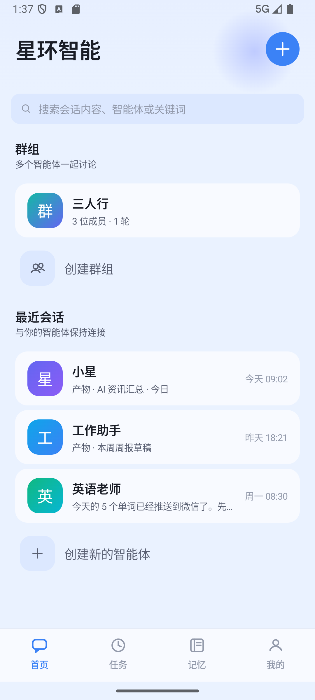
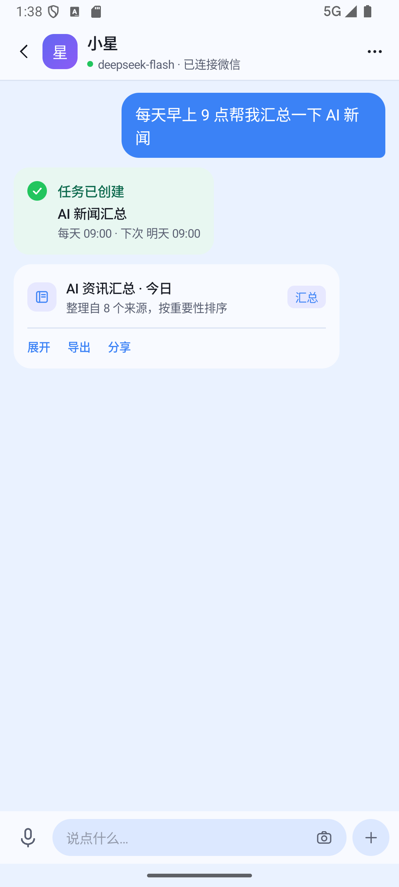
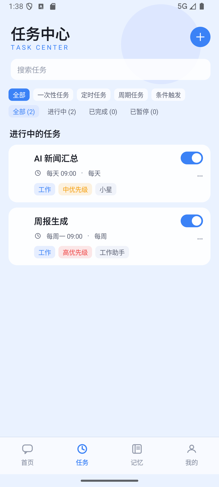
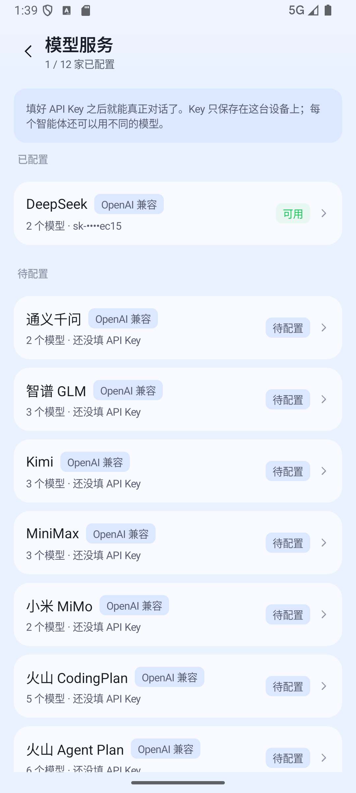
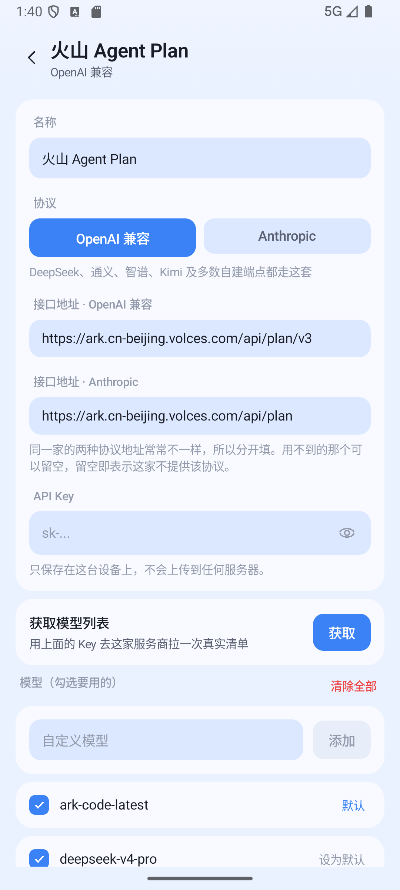
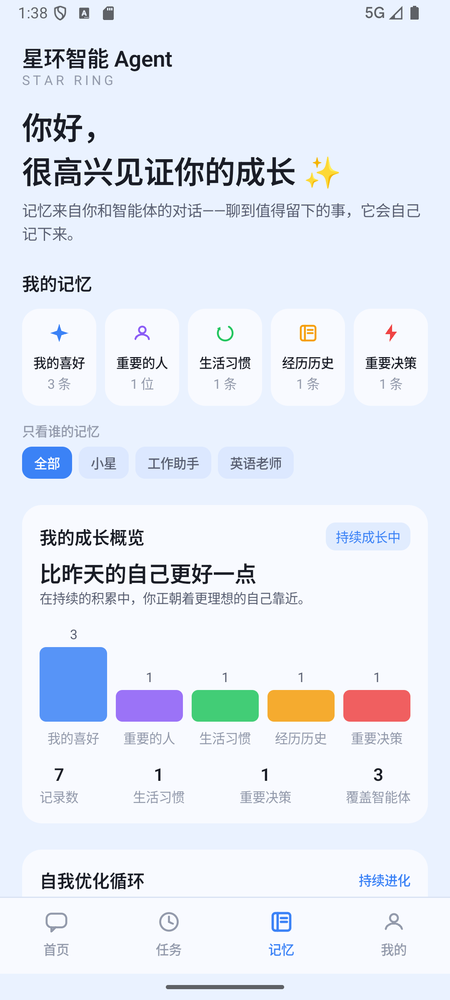
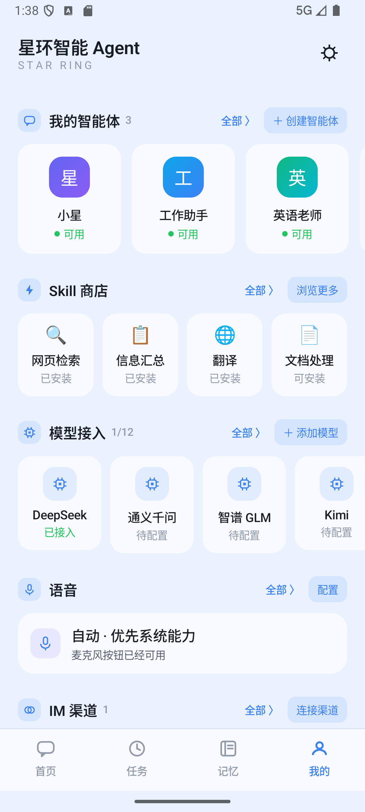
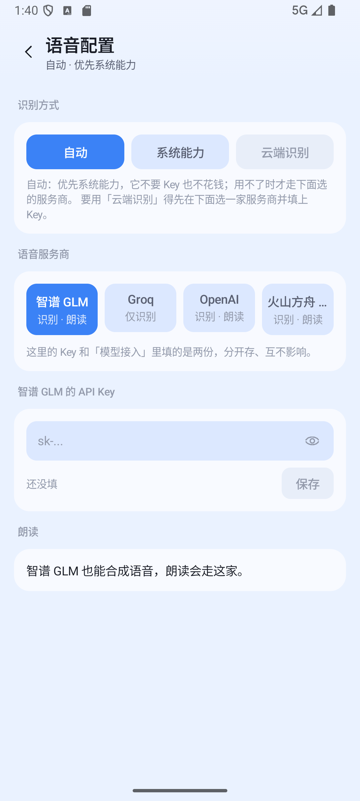

# 星环智能 Agent 一期产品交互形态设计

| 项目 | 内容 |
| --- | --- |
| 文档版本 | v1.0（初稿） |
| 最后更新 | 2026-09-11 |
| 关联文档 | [《星环智能 Agent 产品白皮书》](01-产品白皮书.md) |
| 文档目的 | 定义一期产品的交互主轴与界面结构，作为设计与研发的共识基础 |

---

## 目录

| 章节 | 标题 |
| --- | --- |
| 0 | 前提：一期产品的能力边界 |
| 1 | 核心判断 |
| 2 | 三条设计主线 |
| 3 | 整体信息架构 |
| 4 | 界面详解（4.1 – 4.8） |
| 5 | 四种交互模式 |
| 6 | 渐进式复杂度 |
| 7 | 一期最大的三个交互风险 |
| 8 | 待决策清单 |

---

## 0. 前提：一期产品的能力边界

**一期不做真机操作。** 这一条改变了整个交互设计的出发点，必须先把它的含义说清楚。

没有"手"意味着 Agent 无法代替用户点击屏幕、无法提交表单、无法在别的 App 里办事。那么一期 Agent 到底能交付什么？答案是**认知与信息劳动**：

- 生成与创作（写作、翻译、总结、改写、生成方案）
- 检索与整理（找资料、读长文、汇总信息、做对比）
- 分析与判断（读数据、做决策建议、风险评估）
- 监控与提醒（盯着一件事，到点或出变化就告诉你）
- 通过 Skill 调用外部能力（API 型工具，非屏幕操作）
- 通过 IM 渠道把结果送达用户

**关键推论**：一期的 Agent 是"**有脑、有嘴、没有手**"的。它的能力出口是**内容**和**渠道**，而不是**操作**。交互形态设计必须围绕"让认知劳动变得可见、可沉淀、可托管"来做，而不是假装它能干活。

---

## 1. 核心判断

### 判断一：不要做纯对话产品，但必须让对话做主干

纯对话（类 ChatGPT）是最省事、也最容易做废的形态。因为一期产品的六大能力——**记忆、自进化、Skill、IM 渠道、自定义模型、自定义任务**——**没有一个能被聊天框自然承载**，它们会全部沉到设置菜单里，用户永远看不见，产品就退化成"又一个套壳聊天 App"。

但反过来，如果为了展示这些能力而做一堆功能 Tab，产品就变成了工具箱，冷、碎、没有主线。

**结论：以对话为主干，让其他能力从对话里"长出来"。**

### 判断二：产品终局是"住在 IM 里的 Agent"，所以 App 本身就该像一个 IM

一期支持连接 IM 渠道。这意味着产品的终局形态不是"一个 App"，而是"**一个可以随时被召唤的联系人**"。

那么 App 内部的信息架构就应该提前对齐这个心智：**把它做成一个 IM，只不过你的联系人都是 Agent。** 这样做有四个好处：

1. **多智能体天然成立**——IM 本来就是多联系人的，用户零学习成本。
2. **记忆有了归属**——"这个联系人记得我"，比"系统有一个记忆库"直观得多。
3. **IM 渠道连接顺理成章**——同一个联系人延伸到微信/飞书，用户不会觉得突兀。
4. **语音/拍照有现成范式**——IM 输入框本来就是图文语音混合的。

### 判断三：一期必须用"任务"补上"没有手"的短板

没有真机操作，Agent 的即时价值是有限的（聊完就完）。真正能撑起产品粘性的是**托管**——用户交代一次，Agent 长期负责。

所以**任务不是一期的一个附属功能，而是一期的价值高点**。交互设计上，任务必须是"一等公民"，不能藏在二级菜单。

---

## 2. 三条设计主线

| 主线 | 解决的问题 | 交互落点 |
| --- | --- | --- |
| **对话做主干** | 保证低门槛、有主线 | 首页即对话入口，输入坞统一多模态 |
| **能力从对话里长出来** | 让记忆/任务/技能被看见 | 对话内联卡片、执行过程可视化 |
| **IM 化心智** | 承载多智能体与外部渠道 | 智能体即联系人，消息模型端内端外打通 |

---

## 3. 整体信息架构

```
┌──────────────────────────────────────────────────────┐
│  底部导航（3 个 Tab）                                  │
│  对话（首页）      任务           我的                 │
└──────────────────────────────────────────────────────┘

对话（首页）＝ 智能体联系人列表
    └─ 进入某个智能体 → 对话页
           ├─ 输入坞：文字 / 语音 / 拍照 / 附件
           ├─ 内联卡片：任务创建、结果产物、记忆提示
           └─ 智能体设置：人格 / 模型 / 技能 / 记忆

任务 ＝ 托管中心
    ├─ 进行中（定时 / 周期）
    ├─ 已完成 / 已暂停
    └─ 结果回流到对应对话

我的 ＝ 设置
    ├─ 模型服务商（全局默认）
    ├─ IM 渠道绑定
    ├─ 记忆管理
    └─ 技能管理
```

**为什么一期只有 3 个 Tab，而不是 4 个（不给"技能"独立 Tab）**：一期技能生态还没有内容，独立 Tab 会是一个空货架，伤害产品第一印象。技能改为在两个**上下文**里出现：① 对话里的"＋添加技能"；② 智能体设置里的"能力"。等生态有内容了再提升为一级 Tab。

---

## 4. 界面详解

### 4.1 首页：智能体联系人列表

```
┌───────────────────────────────┐
│  星环                    ＋  ⋯ │
├───────────────────────────────┤
│  🔍 搜索                      │
├───────────────────────────────┤
│  ◉ 小星                  刚刚  │
│    今日AI新闻已汇总，点击查看   │
├───────────────────────────────┤
│  ◉ 工作助手              昨天  │
│    周报草稿已生成              │
├───────────────────────────────┤
│  ◉ 英语老师              周一  │
│    今天的 5 个单词已推送       │
├───────────────────────────────┤
│  ⊕ 创建新的智能体              │
├───────────────────────────────┤
│    💬         ⏰         ⚙️    │
│   对话       任务       我的   │
└───────────────────────────────┘
```

**实现截图**：



**设计要点**：

- **每行是一个智能体，同时承载三类动态**：用户与它的对话、它托管的任务结果、它的主动消息。三者共用同一条消息流，这就是 IM 的心智——你看到的是"这个联系人最近发生了什么"。
- 行摘要显示**最有信息量的一条**，而不是简单的时间戳。
- **单智能体场景**：新用户首次使用时会直接落在默认智能体的对话页（onboarding），返回后看到的就是列表 + "创建新的智能体"入口，不会显得空。
- 右上角 `＋` 是快捷创建，`⋯` 放全局操作（全部标记已读等）。

### 4.2 对话页

```
┌───────────────────────────────┐
│  ←  小星          GPT-4o  ⚙️ ⋯ │
│     已连接微信                 │
├───────────────────────────────┤
│                               │
│              每天9点帮我汇总    │
│              一下AI新闻        │
│                               │
│  ┌─────────────────────────┐  │
│  │ 好的，我把它做成一个任务： │  │
│  │ ┌─────────────────────┐ │  │
│  │ │ ⏰ 每天 09:00        │ │  │
│  │ │ 📤 推送到微信         │ │  │
│  │ │ 🧩 用到：网页检索      │ │  │
│  │ │   [ 创建 ]  [ 修改 ]  │ │  │
│  │ └─────────────────────┘ │  │
│  └─────────────────────────┘  │
│                               │
│  ┌─────────────────────────┐  │
│  │ ✓ 正在检索 8 个来源       │  │
│  │ ✓ 已完成汇总              │  │
│  │ ▸ 查看产物                │  │
│  └─────────────────────────┘  │
│                               │
├───────────────────────────────┤
│  🎤  ┌───────────────┐  📷 ＋  │
│      │ 说点什么…      │        │
│      └───────────────┘        │
└───────────────────────────────┘
```

**实现截图**（对话里说完一句话，任务卡片与产物卡片都在同一条流里）：



**设计要点**：

- **标题栏常驻状态位**：`GPT-4o · 已连接微信`。这是把"模型自由"和"IM 连接"两个卖点变成**持续可见的状态**，而不是藏在设置里的开关。用户可以点它直接切换模型或渠道。
- **输入坞三合一**：`🎤 语音` + `输入框` + `📷 拍照` / `＋ 附件`。语音和拍照是**输入方式的补充**，不另开独立模式，避免用户在多个入口间迷路。
- **执行过程可视化**：Agent 工作时展示步骤（检索 → 分析 → 生成），让用户感知"它在为我工作"，而不只是"它在打字"。这是无真机操作阶段**建立信任感的关键**——没有可见的过程，用户无法判断结果可信度。
- **输出物化**：较长或结构化结果（报告、清单、表格）折叠成**产物卡片**，可展开、可导出、可分享。原因很重要：聊天流里的文字会"流走"，而产物可以沉淀下来被反复使用。一期的"交付感"全靠这个。

**产物卡片是本期最重要的设计发明点。** 它把"聊天记录"变成"工作成果"，直接对应用户的心智——我要的不是一段话，是一个能用的东西。

### 4.3 核心交互创新：对话即任务创建

这是整个交互设计的**枢纽**，单列出来强调。

**传统做法**：用户去"任务"Tab → 点新建 → 填表单（时间、频率、内容、输出方式）→ 保存。结果是没人用。

**推荐做法**：用户在对话里用自然语言说"每天9点帮我汇总AI新闻" → Agent 识别出这是一个**可托管的任务** → 在对话流里弹出一张**任务草稿卡片**，参数已填好 → 用户点"创建"即可。

```
自然语言  →  任务草稿卡片  →  确认创建
```

**为什么这个设计重要**：

- **用户不需要理解"任务"这个概念**。他只是在说话，Agent 替他做了抽象。
- **创建成本从"填表单"降到"点一下"**，任务功能才可能真正被用起来。
- **对话是主干的设计因此自洽**——任务从对话里长出来，而不是另一个世界的功能。

**设计约束**：

- 卡片必须**可修改**（改时间、改频率、改输出渠道），不能只有"创建"。
- Agent 判断在**不确定时应该追问**（"你希望每天几点？"），而不是猜错了直接创建。
- 创建成功后，任务与**创建它的对话绑定**，结果回流到这条对话里。
- **任务能力是智能体级的开关，不是全局行为。** 只有"把事情交出去"才是建任务的信号；
  提问、闲聊、以及此刻就能给出结果的一次性请求，都该直接回答。
  新智能体**默认关闭**这个能力——否则每一段对话都可能被塞进一张任务卡片，
  用户想好好聊天都做不到。

### 4.4 任务中心

```
┌───────────────────────────────┐
│  任务                      ＋  │
├───────────────────────────────┤
│  进行中                        │
│  ┌─────────────────────────┐  │
│  │ ⏰ AI新闻汇总    [每天9:00]│  │
│  │   下次：明天 09:00        │  │
│  │   上次：今天 09:02 ✓      │  │
│  └─────────────────────────┘  │
│  ┌─────────────────────────┐  │
│  │ 🔄 周报生成     [每周一]  │  │
│  │   下次：9月15日 09:00     │  │
│  └─────────────────────────┘  │
├───────────────────────────────┤
│  已暂停 / 已完成               │
│  …                            │
└───────────────────────────────┘
```

**实现截图**（比线框图多了一层筛选：类型 chips + 状态计数）：



**设计要点**：

- 任务中心是**管理视图**，不是**主消费场景**。用户平时看结果的入口是对话，不是这里。
- 每条任务显示三个状态：**频率、下次执行、上次结果**。这三个信息决定了用户对"它到底有没有在干活"的信任。
- 任务详情页要有**执行历史**，可以点开看每一次的结果。

### 4.5 智能体创建与配置

```
┌───────────────────────────────┐
│  ←  创建智能体                 │
├───────────────────────────────┤
│  从模板开始                    │
│  ┌────┐┌────┐┌────┐┌────┐    │
│  │通用││写作││学习││工作│    │
│  └────┘└────┘└────┘└────┘    │
│  ┌────┐                       │
│  │空白│                       │
│  └────┘                       │
├───────────────────────────────┤
│  或直接描述你想要的智能体       │
│  ┌─────────────────────────┐  │
│  │ 一个说话直接、擅长帮我做   │  │
│  │ 技术选型对比的助手        │  │
│  └─────────────────────────┘  │
│                    [ 生成 ]   │
└───────────────────────────────┘
```

**设计要点**：

- **双路径创建**：模板（快）和自然语言描述（自由）。后者直接体现"高自由度"，且比填一堆字段友好得多。
- **提示词生成**：用户用一句话描述，系统生成人设（system prompt），用户可再编辑。**不要把 system prompt 裸露给用户填**——那是开发者的交互，不是用户的。
- 智能体设置页包含五块：**人格**（人设、提示词）、**模型**（可覆盖全局默认）、
  **能力**（是否允许把对话变成托管任务，默认关闭）、**技能**（挂载哪些 Skill）、**记忆**（这个智能体的记忆范围）。

### 4.6 模型配置：一期的第一道生死关

**列表页**按"能不能用了"分组，而不是把可选项堆成一排开关：

```
┌───────────────────────────────┐
│  ←  模型服务      2 / 5 家已配置│
├───────────────────────────────┤
│  已配置                        │
│  ◉ DeepSeek      [OpenAI 兼容] │
│    2 个模型 · sk-••••a1b2 [可用]│
├───────────────────────────────┤
│  待配置                        │
│  ○ 通义千问      [OpenAI 兼容] │
│    2 个模型 · 还没填 API Key   │
│  ○ Anthropic     [Anthropic]  │
│    2 个模型 · 还没填 API Key   │
├───────────────────────────────┤
│  ＋ 添加自定义服务商            │
│    支持 OpenAI 兼容与 Anthropic │
└───────────────────────────────┘
```

**实现截图**：



点进某一家，是**服务商详情页**——配 Key、拉模型、挑模型都在这一页完成：

```
┌───────────────────────────────┐
│  ←  DeepSeek                  │
├───────────────────────────────┤
│  名称     [DeepSeek          ] │
│  协议     [OpenAI 兼容][Anthropic]│
│  接口地址 [https://api.deepseek…]│
│  API Key  [sk-...            ] │
├───────────────────────────────┤
│  获取模型列表        拉到 12 个 │
│                          [获取]│
├───────────────────────────────┤
│  模型（勾选要用的）             │
│  ☑ deepseek-chat         默认  │
│  ☑ deepseek-reasoner  设为默认 │
│  ☐ deepseek-coder             │
└───────────────────────────────┘
```

**实现截图**（真实截图里的这一页是「火山 Agent Plan」，正好把三件后来加的东西都拍进去了：
API Key 已改成**默认掩码**、右侧有眼睛；模型区右上角是**清除全部**；
下面那行是**自定义模型**——不是每家都有 `/models` 可拉，得能手动加）：



**这是全产品最容易被低估的风险点。** 一期产品的燃料就是模型，**没有配置模型的用户，打开 App 什么都做不了**。而"让用户自己去某厂商官网注册、充值、申请 API Key、再回来粘贴"这个漏斗，会筛掉绝大多数普通用户。

已实现的缓解手段：

1. **预置主流服务商**，接口地址和常见模型名都已填好，用户只需要补一个 Key。
2. **模型名多数时候不用手打**——点「获取模型列表」会真的去该服务商拉一次当前可用的清单，
   再从中勾选，并指定哪个是默认模型。**但这不是唯一的路**：有的服务商根本没有 `/models`
   接口（火山方舟就是 404），所以详情页另外给了**「自定义模型」**手动添加，
   以及**「清除全部」**把预置的、拉回来的整份推倒。
   预置的模型名一旦过时、又拉不回来，用户得有办法绕过它，否则这一家就等于用不了。
3. **没配好时给出明确指引**：对话页顶部常驻一条提示条，点它直达配置页，而不是让用户对着输入框猜为什么没反应。
4. **失败原因翻译成人话**：401/403 说"API Key 无效或没有权限"、404 说"接口地址或模型名不对"、429 说"触发限流"，而不是把 HTTP 状态码甩给用户。
5. **自定义服务商**支持两种协议二选一（OpenAI 兼容 / Anthropic），接口地址与模型清单都由用户填——这是"模型自由"最彻底的落点。
6. **API Key 默认掩码**，右侧一个眼睛点开才明文。Key 存在设置页里、又是最容易被截图分享的位置，
   不该默认摊在屏幕上。（注意这挡的是"屏幕被别人看到"，不是"磁盘被别人读到"——
   落盘仍是明文，真要护住后者得上系统钥匙串。）

**但根子上的问题还在。** 以上只是把漏斗修得不那么陡，并没有消除它。真正把非技术用户挡在门外的，是"必须先有一个 API Key"这件事本身，而这只有**官方托管通道**（平台代付、零配置可用）能解决——它需要后端服务，一期没有，因此界面上没有留一个点不动的假开关。

**同时要守住"模型自由"的承诺**：即便将来有了官方通道，它也只能是**默认项**而非**唯一项**。高级用户随时可以切到任意服务商，或接入自建端点——这是产品的立身之本，不能在体验优化中被弱化。

### 4.7 记忆的可见性

记忆是最容易做成"隐形功能"的东西——用户不知道它存在，就不会感知到价值。

**推荐做法**：

- **轻量可见**：Agent 在用到某条记忆时，在消息上挂一个小标记，如"📍 我记得你偏好简洁的回答"。让记忆在自然场景中露出。
- **管理页**：`我的 → 记忆`，按类型分组（偏好 / 事实 / 习惯 / 项目），每条可编辑、可删除，也可手动新增。
- **智能体级隔离**：不同智能体的记忆默认不互通（符合 IM 心智——你不会把工作助手的话转述给英语老师）。

**实现截图**（实际做出来的是五类：我的喜好 / 重要的人 / 生活习惯 / 经历历史 / 重要决策。
除列表外还加了一张「我的成长概览」——把记忆条数画成柱状。
这是对"容易被做成隐形功能"的直接回应：光有内容不够，还得让用户**看见它在长**）：



### 4.8 外部触点：IM 渠道

```
        App 内                          外部 IM
   ┌──────────────┐              ┌──────────────┐
   │  对话页       │  ←──同步──→  │  微信/飞书    │
   │              │              │  里的"小星"   │
   └──────────────┘              └──────────────┘
          同一条会话、同一份记忆、同一个任务
```

**设计要点**：

- 绑定后，Agent 以**联系人**形式出现在 IM 里，**同一条会话双向同步**——在 App 里说的话，IM 里能接上；IM 里交代的任务，App 里能看到结果。**绝不能做成两套独立会话**，那会让用户困惑且记忆割裂。
- 任务结果的**默认推送目的地**可以选择 IM，这正是"没有手"的一期里，Agent 触达用户的主要方式。

---

## 5. 四种交互模式（时间维度的完整覆盖）

这四种模式合起来，才构成一个完整的 Agent 产品，而不是聊天软件：

| 模式 | 时间 | 用户动作 | 形态 |
| --- | --- | --- | --- |
| **即时对话** | 现在 | 我问，它答 | 对话页 |
| **托管任务** | 以后 | 我交代，它按时办 | 对话内联创建 + 任务中心 |
| **外部召唤** | 别处 | 在 IM 里叫它 | IM 联系人 |
| **主动触达** | 它找我 | 接收结果与提醒 | 消息流 + 推送 |

**"主动触达"需要单独设计打扰预算**——这是 Agent 类产品最常见的翻车点：任务一多就变成通知轰炸，用户第一反应是关推送、第二反应是卸载。建议：

- 同类任务结果**合并推送**，而不是每条一推；
- 提供**免打扰时段**与**推送频率上限**；
- 区分**结果类**（可以晚点看）和**提醒类**（必须准时）两类通知，走不同通道。

---

## 6. 渐进式复杂度：高自由度怎么不吓跑新用户

"高自由度"是产品卖点，但也是新用户最大的门槛。一个满是配置项的 App，第一印象是"这玩意儿好复杂"。

**推荐：能力分三层递进，每层都有默认值兜底。**

| 层级 | 面向 | 用户需要做的事 |
| --- | --- | --- |
| **第一层：开箱即用** | 所有新用户 | 什么都不用配，直接说话 |
| **第二层：个性化** | 用了一周的用户 | 改人设、创建第二个智能体、挂技能 |
| **第三层：完全自定义** | 极客用户 | 换模型服务商、自定义提示词、接 IM |

**关键原则：每一层的默认值都必须是"能直接用的好默认"，而不是"空的占位符"。** 用户不配置也应该有完整体验，配置只是让它更贴合自己。

---

## 7. 一期最大的三个交互风险

| 风险 | 说明 | 应对 |
| --- | --- | --- |
| **模型配置漏斗** | 没有模型 = 产品是死的；要用户自备 Key 会筛掉大部分人 | 官方托管通道做默认，零配置可用 |
| **"没有手"的价值感弱** | 只能输出内容，用户可能觉得"聊完就完了" | 产物卡片沉淀结果 + 任务托管长期价值 |
| **任务被做成隐藏功能** | 任务是一期价值高点，但容易被埋进二级菜单 | "对话即任务创建"，让任务从对话里长出来 |

---

## 8. 待决策清单

评审时建议逐条拍板：

1. 首页采用**智能体列表**（本文推荐）还是**直接进入主智能体对话**（左上角抽屉切换）？
2. 一期是否提供**官方模型通道**？定价与成本模型如何设计？（**最高优先级**）
3. "技能"一期是否给独立入口，还是完全上下文化？
4. 任务结果的**默认推送渠道**：仅 App 内，还是默认同步到 IM？
5. 语音一期做到什么程度——**输入方式**（转文字，本文推荐）还是**全语音对话**？
6. 记忆是否**跨智能体共享**？本文推荐默认隔离、可选共享。
7. 产物卡片支持哪些**导出格式**（文本 / 图片长图 / Markdown / 文档）？

---

## 9. 实现说明（一期原型）

本文已实现为可运行的 Compose Multiplatform 原型，工程位置与模块划分见
[`StarAgentApp/StarAgent/README.md`](../StarAgentApp/StarAgent/README.md)。
界面、状态与模型接入全部在 `commonMain`，三端共用。

实现过程中对设计稿做了三处调整：

1. **对话页状态位与模型选择**（对应 4.2 / 4.6）。设计稿里顶栏直接显示模型名，
   实现改为：顶栏显示 `模型 · 渠道` 状态位，点击展开面板，面板内**先响应模式、后模型**。
   用户关心的是"这次要快还是要深"，而不是模型的名字；
   但"模型自由"是立身之本，所以两者都给，只是排序不同。

2. **任务的下次执行时间**。草稿卡片的"下次执行"由草稿中解析出的时刻生成，
   避免出现"每天 10:00"却写"下次 明天 09:00"的自相矛盾。

3. **对话即任务创建改由模型驱动，并做成智能体级开关**（对应 4.3 / 4.5）。
   设计稿没有规定这件事该由谁判断。实现是让系统提示要求模型在识别出可托管意图时，
   于回复末尾附一个 ` ```task ` JSON 块，解析器再把它变成草稿卡片。
   解析失败就按普通回复处理——模型没按格式输出，绝不能因此让用户看不到它的回答。

   后来又加了一层约束：**这个能力按智能体开关，且新智能体默认关闭**。
   初版是实现成全局行为的，结果普通会话里也动不动弹任务卡片。
   现在提示里明确划开了"把事情交出去"（反复做 / 将来触发）与"现在就能回答"（提问、闲聊、一次性请求），
   关掉能力时提示里连任务指令都不会出现。

### 运行方式

```bash
./gradlew :desktopApp:run           # 桌面预览（窗口按手机比例）
./gradlew :androidApp:assembleDebug # Android
./gradlew :core:data:jvmTest        # 测试
```

### 已实现

**四 Tab 结构**（首页 / 任务 / 记忆 / 我的）、智能体联系人列表、对话页（状态位 / 输入坞 /
任务草稿卡片 / 产物卡片 / 记忆提示 / 流式输出与中断）、对话即任务创建的完整闭环、
任务中心、智能体创建与配置、记忆管理、技能管理、存储文件浏览器。

**模型接入**是完整可用的：两种协议（OpenAI 兼容 / Anthropic）、**十二家内置服务商**、
自定义服务商（协议二选一）、拉取模型列表、自定义模型与清除全部、选择默认模型、
API Key 本地持久化并默认掩码，以及把 401 / 404 / 429 等失败翻译成可读提示。
所有智能体共用全局默认模型，不再按智能体单独切换；响应模式也是全局的，在「我的」页里设。

**语音**是一份**独立于对话的配置**（`我的 → 语音`）：三档识别方式（自动 / 系统能力 / 云端识别）、
四家语音服务商、识别与朗读分开——不做合成的服务商，朗读自动退回设备自带。
拆开的理由是：语音的可用性不该取决于**对话那把 Key** 配没配，用户看到的"待配置"必须说的是同一件事。





### 尚未实现（设计稿中已定义，但一期原型未落地）

- 产物卡片的"导出 / 分享"目前只有入口，没有实际动作
- IM 渠道：原先的开关式模拟绑定已移除，等真实的渠道接入做好后再加回来
- 拍照识别只有入口按钮
- 记忆的跨智能体共享策略（当前固定为按智能体隔离）
- ~~记忆尚未真正参与推理~~：已通过 `core:tools` 内置的 `recall_memory` 与 `remember` 工具打通召回与写回，真正参与模型推理循环
- 任务调度现在通过 `AgentLoop` 在前台心跳时真实执行工具（已非单纯表演），但系统级的后台 Alarm/WorkManager 调度尚未接入
- iOS 目标只写了代码，尚未在 Mac 环境编译验证

### 验过与没验过的

写在这里免得后人误判进度：

- **语音的在线那条没有连过真实服务**。请求的形状（路径、请求头、请求体）有测试钉着，
  本机也起过假服务器把请求接住核对；但**没有拿真 Key 跑通过一次**，
  所以"服务商真的能认出来、真的能合成出来"这两条仍是空的。
- 火山方舟的语音走的是 Agent Plan 的 `/plan/` 专线（识别是 WebSocket 二进制帧，
  合成是带 `/plan/` 的 HTTP）。它的帧编解码有测试，**连接本身没验过**。
  凭据要填方舟那把 Agent Plan Key——语音控制台单独发的 Key 是另一套，两不通用。
